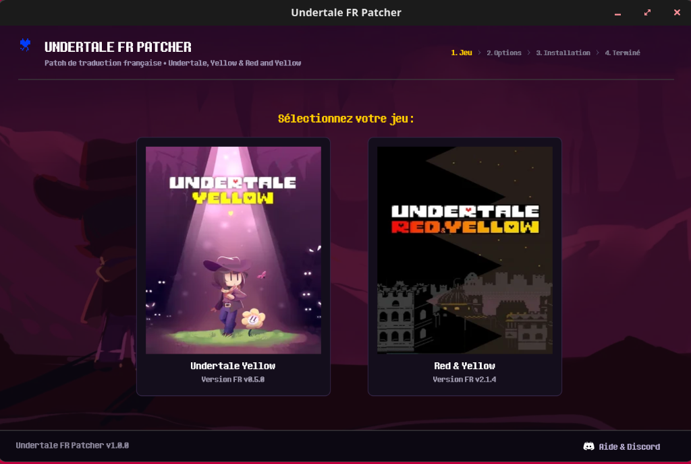

<div align="center">

# Undertale FR Patcher

**Patcher multiplateforme pour les traductions francaises d'Undertale Yellow et Red & Yellow**

[Releases](https://github.com/cronos-neo/undertale-fr-patcher/releases) · [Site Officiel](https://undertale-fr.cronos.build) · [Discord Communaute](https://discord.gg/mAwZBxhSSf)

<br/>

<p align="center">
  
</p>

</div>

---

## Communaute et Discord

Pour toute question, assistance technique lors de l'installation, signalement de bug ou pour suivre les prochaines mises a jour des patchs, rejoignez le serveur Discord de la communaute :

-> **[Rejoindre le Discord Undertale Yellow FR](https://discord.gg/mAwZBxhSSf)**

Les agents IA et developpeurs travaillant sur le projet sont invites a consulter le serveur pour coordonner les retours et les corrections de traduction.

---

## Telechargements et Utilisation

Les executables precompiles pour Linux et Windows sont disponibles sur la page des [Releases](https://github.com/cronos-neo/undertale-fr-patcher/releases).

1. Telechargez la derniere version correspondant a votre systeme (`undertale-fr-patcher-linux` ou `undertale-fr-patcher-windows.exe`).
2. Lancez l'application. Le patcher detecte automatiquement l'installation du jeu (Steam ou DRM-free) ou vous permet de selectionner manuellement le dossier.
3. Selectionnez la traduction souhaitee (Undertale Yellow ou Red & Yellow) et appliquez le patch.

Le processus applique les patchs differentiels sans modifier vos fichiers de sauvegarde existants.

---

## Compilation depuis les Sources

### Prerequis
- Rust 1.80 ou superieur (`cargo`, `rustc`)
- Sur Linux : bibliotheques standards (`libx11-dev`)

```bash
git clone https://github.com/cronos-neo/undertale-fr-patcher.git
cd undertale-fr-patcher/zenith-patcher-rs
cargo build --release
```

Le binaire compile se situe dans `target/release/undertale-fr-patcher`.

---

## Architecture du Depot

- `zenith-patcher-rs/` : Code source Rust du patcher (interface `egui`, rendu CPU logiciel `softbuffer`).
- `patches/` : Fichiers differentiels `.xdelta`.
- `versions.json` : Index des versions disponibles et URLs de telechargement.

---

## Liens Utiles

- Site web vitrine : [undertale-fr.cronos.build](https://undertale-fr.cronos.build)
- Depot du site : [cronos-neo/undertale-fr](https://github.com/cronos-neo/undertale-fr)
- Serveur Discord : [https://discord.gg/mAwZBxhSSf](https://discord.gg/mAwZBxhSSf)
