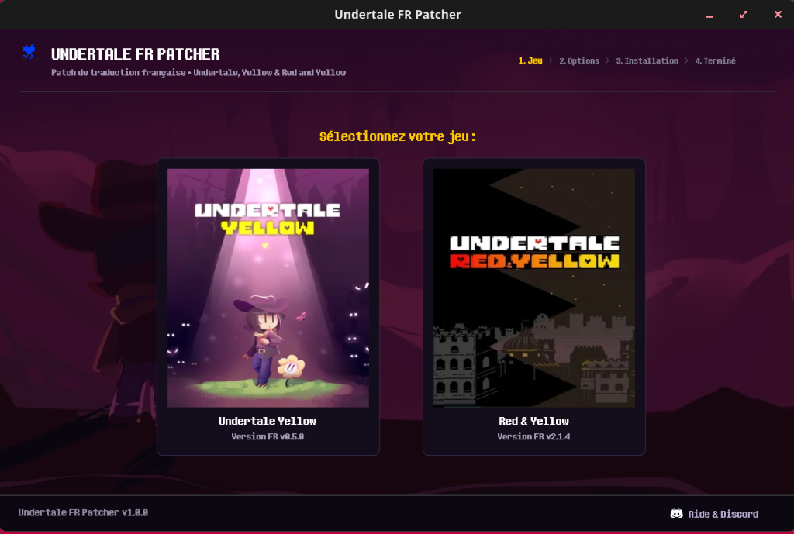

<div align="center">

# Undertale FR Patcher

**Utilitaire Autonome Multiplateforme d'Application de Patchs Binaires (Rust / egui)**

[Dépôt Source](https://github.com/cronos-neo/undertale-fr-patcher) · [Portail Web](https://undertale-fr.cronos.build) · [Spécifications Techniques](https://cronos.build)

<br/>

<p align="center">
  
</p>

</div>

---

## Vue d'ensemble

Undertale FR Patcher est un utilitaire natif écrit en Rust permettant d'appliquer de manière non destructive les patchs de traduction française pour **Undertale Yellow** et **Undertale Red & Yellow**.

Conçu pour fonctionner de façon déterministe sur Linux, SteamOS (Steam Deck) et Windows, il intègre un moteur graphique CPU pur ne nécessitant aucune accélération GPU matérielle, garantissant une compatibilité immédiate avec les environnements contraints et les couches de compatibilité Proton / Wine.

---

## Spécifications Architecturales

| Domaine | Implémentation |
|---|---|
| **Langage & Écosystème** | Rust (édition 2021), compilation optimisée `opt-level = "z"`, LTO activé |
| **Interface Graphique** | `egui` 0.34 avec backend logiciel `softbuffer` (rendu CPU frame-par-frame) |
| **Moteur Différentiel** | Orchestration xdelta3 intégrée sous forme de binaires embarqués au build |
| **Contrôle d'Intégrité** | Vérification cryptographique des sommes SHA-256 via la crate `sha2` |
| **Gestion Réseau** | Client HTTP minimaliste et synchrone `minreq` avec TLS Rustls natif |
| **Détection Système** | Analyse heuristique des bibliothèques Steam (`libraryfolders.vdf`) et dossiers de jeu |

---

## Processus d'Application

```
[1. Détection] ──> Recherche automatique des exécutables originaux (Steam / DRM-Free)
       │
[2. Vérification] ──> Hachage SHA-256 de la source (game.unx / data.win)
       │
[3. Résolution] ──> Téléchargement sécurisé du patch delta selon versions.json
       │
[4. Patching] ──> Décompression et injection atomique via xdelta3
       │
[5. Raccourcis] ──> Génération de l'entrée .desktop (Linux) ou du raccourci bureau
```

---

## Structure du Dépôt

```
undertale-fr-patcher/
├── zenith-patcher-rs/       # Crate Rust principale du patcher
│   ├── src/
│   │   └── main.rs          # Logique d'application, états GUI et exécution
│   ├── assets/              # Icônes et captures d'interface
│   ├── bin/                 # Exécutables xdelta3 embarqués (Linux & Windows)
│   ├── Cargo.toml           # Dépendances et profils d'optimisation
│   └── build.rs             # Configuration de build et intégration des ressources
├── patches/                 # Fichiers différentiels .xdelta
├── versions.json            # Index canonique des versions et hachages distants
└── README.md                # Documentation technique
```

---

## Compilation depuis les Sources

### Prérequis
- Chaîne d'outils Rust 1.80+ (`cargo`, `rustc`)
- Dépendances système standard (sur Linux : `libx11-dev`, `libasound2-dev` si audio actif)

```bash
# Cloner le dépôt
git clone https://github.com/cronos-neo/undertale-fr-patcher.git
cd undertale-fr-patcher/zenith-patcher-rs

# Compilation en mode release optimisé
cargo build --release
```

Le binaire final est produit dans `target/release/undertale-fr-patcher`.

---

## Format Canonique `versions.json`

Le patcher interroge ce schéma distant pour valider les numéros de version et hachages admissibles :

```json
{
  "projects": {
    "uty-fr": {
      "version": "0.5.0",
      "patch_url": "https://.../uty-fr-v0.5.0.xdelta",
      "patch": {
        "filename": "uty-fr-v0.5.0.xdelta",
        "sha256": "c227defe6d78994e3f1b9323a0c462a91906049bbf381930ca6964eeda23dfa3",
        "size": 56653766
      }
    }
  }
}
```

---

## Licence & Droits

Distribué sous licence MIT. Développé par **Cronos** et **Anthan**.
Undertale est une marque déposée de Toby Fox. Undertale Yellow et Red & Yellow sont des créations de leurs équipes respectives.
